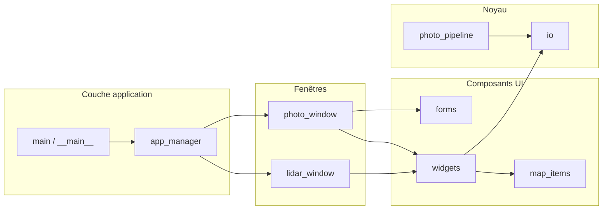

# Modulariser le projet Forest View pour la collaboration

## Problèmes actuels

- **Fichier « bibliothèque » unique** : [Librairie.py](Librairie.py) (~580 lignes) mélange widgets d’interface, utilitaires I/O et logique de traitement des photos. `from Librairie import *` est utilisé partout, ce qui masque les dépendances et complique les fusions et les tests.
- **Fichier d’application unique** : [Lidar-forest-view.py](Lidar-forest-view.py) regroupe `AppManager`, `PhotoWindow` et `LidarWindow` au même endroit, ce qui empêche plusieurs personnes de travailler facilement en parallèle sur la partie photo, lidar ou logique applicative.
- **Absence de structure en package** : tout se trouve à la racine du dépôt ; il n’y a pas de séparation claire entre « données », « interface », « application » ou « point d’entrée ».

## Structure recommandée

Introduire un package (par ex. `forest_view/` ou `src/`) et découper par responsabilité :

- **Noyau / I/O** : regrouper CSV, JSON et les utilitaires de fichiers dans un seul module pour que tous les scripts (application de visualisation, project_maker, Creation_projets) s’appuient sur un même endroit pour « lire/écrire les données du projet ».
- **Composants UI** : les répartir en petits modules (formulaires, widget panorama, widget carte + éléments de carte, widget propriétés) pour qu’un fichier = une responsabilité claire, modifiable sans toucher au reste.
- **Fenêtres** : un module par fenêtre (`photo_window`, `lidar_window`) pour qu’une personne puisse gérer l’interface photo et une autre l’interface lidar.
- **Application** : point d’entrée léger + `AppManager` qui se contente de créer les fenêtres et de charger le projet ; pas de logique UI ou métier en son sein.

## Organisation proposée

| Chemin                                 | Responsabilité                                                                                                                        |
| -------------------------------------- | ------------------------------------------------------------------------------------------------------------------------------------- |
| `forest_view/` (ou `src/forest_view/`) | Racine du package                                                                                                                     |
| `forest_view/io.py`                    | `readCSV`, `CSV_to_dict`, `writeCSV`, `readJSON`, `writeJSON`, `export_photo_info_to_csv`                                             |
| `forest_view/photo_pipeline.py`        | `get_valid_pairs`, `stitch_photos`, `get_photo_locations`, `quaternion_to_euler` (optionnel : séparer Hugin/assemblage si ça grossit) |
| `forest_view/forms.py`                 | `DataForm` (et autres boîtes de dialogue)                                                                                             |
| `forest_view/widgets/`                 | Sous-package pour les widgets réutilisables                                                                                           |
| `forest_view/widgets/gl_panorama.py`   | `GLWidget` (sphère OpenGL + texture)                                                                                                  |
| `forest_view/widgets/map.py`           | `CustomMapWidget`, `Pointer`                                                                                                          |
| `forest_view/widgets/map_items.py`     | `PhotoPoint`, `TreePoint`                                                                                                             |
| `forest_view/widgets/properties.py`    | `ProprietyWidget`                                                                                                                     |
| `forest_view/windows/photo_window.py`  | `PhotoWindow` (mise en page + `change_site`)                                                                                          |
| `forest_view/windows/lidar_window.py`  | `LidarWindow` (plotter PyVista, load_point_cloud, add_trees, synchronisation caméra, picking)                                         |
| `forest_view/app_manager.py`           | `AppManager` (formulaire, chargement projet, création des fenêtres, connexion des signaux)                                            |
| `forest_view/__main__.py` ou `main.py` | Configuration de l’app Qt, `QSurfaceFormat`, lancement de `AppManager`                                                                |

- **Point d’entrée** : garder un script unique à la racine si vous préférez (ex. `Lidar-forest-view.py` ou `run.py`) qui fait `from forest_view import run` ou `from forest_view.app_manager import AppManager` et lance l’app. Sinon, lancer avec `python -m forest_view` via `__main__.py`.

## Stratégie d’imports

- **Supprimer `from Librairie import ***` : remplacer par des imports explicites dans chaque fichier (ex. `from forest_view.io import CSV_to_dict` ; `from forest_view.widgets.map import CustomMapWidget`). Les dépendances deviennent visibles et les collisions de noms sont évitées.
- **Compatibilité ascendante (optionnel)** : pendant la transition, conserver un `Librairie.py` minimal qui réexporte depuis les nouveaux modules pour que les scripts existants (`project_maker.py`, `Creation_projets/*.py`) continuent de fonctionner jusqu’à ce qu’on les migre vers `forest_view.*`.

## Bénéfices pour la collaboration

- **Travail en parallèle** : un dev peut modifier `lidar_window.py` et un autre `photo_window.py` ou `map_items.py` avec peu de chevauchement.
- **Responsabilités claires** : carte, panorama, propriétés et lidar peuvent être attribués à des personnes différentes ; les changements restent localisés à un ou deux fichiers.
- **Tests** : les petits modules (ex. `io`, `photo_pipeline`, widgets) peuvent être testés unitairement sans lancer toute l’app Qt.
- **Intégration** : un nouveau contributeur sait où chercher « où lit-on le CSV ? » ou « où est la vue 3D lidar ? ».

## Ordre de mise en œuvre (résumé)

1. Créer le répertoire du package et `forest_view/io.py` (déplacer les utilitaires I/O depuis Librairie), puis `forest_view/photo_pipeline.py` (assemblage/localisation ; ils ne dépendent que de `io` ou de la stdlib).
2. Créer `forest_view/forms.py` et `forest_view/widgets/*` (formulaires et widgets) ; les widgets importent depuis `forest_view.io` et `forest_view.forms` au besoin. En cas d’imports circulaires, déplacer types ou constantes partagés dans un petit `forest_view/common.py`.
3. Créer `forest_view/windows/photo_window.py` et `forest_view/windows/lidar_window.py` en déplaçant la logique depuis `Lidar-forest-view.py` ; ils importent depuis `forest_view.widgets.*` et `forest_view.io`.
4. Ajouter `forest_view/app_manager.py` et le point d’entrée ; tout le câblage se fait là, et on retire la logique dupliquée du script d’origine.
5. Remplacer `from Librairie import *` dans `Lidar-forest-view.py`, `project_maker.py` et `Creation_projets/*.py` par des imports explicites depuis `forest_view.*` (ou garder un `Librairie.py` stub qui réexporte et migrer les appelants progressivement).
6. Lancer l’app, project_maker et les scripts Creation_projets utilisés pour valider le comportement ; ajouter une courte note dans le README ou CONTRIBUTING pour décrire la nouvelle structure.

## Améliorations optionnelles

- **Constantes** : si les noms de fichiers projet (`photo_info.csv`, `tree_info.csv`, `cloud.laz`, etc.) ou chemins par défaut sont utilisés dans plusieurs modules, les centraliser dans `forest_view/constants.py` ou `config.py`.
- **Annotations de type** : ajouter des indications de type basiques dans `io` et dans les constructeurs des fenêtres/widgets pour clarifier les contrats pour les collaborateurs.
- **Logique lidar** : si `load_point_cloud` / `add_trees` s’enrichissent (formats multiples, filtrage), envisager un petit `forest_view/lidar_loader.py` utilisé uniquement par `lidar_window`.

Ce plan conserve le comportement actuel tout en rendant le code modulaire et adapté au travail en équipe. Si vous préférez ne prioriser qu’une partie (ex. découper d’abord Librairie et laisser les fenêtres dans un seul fichier), on peut le faire en première phase et le reste dans une seconde.